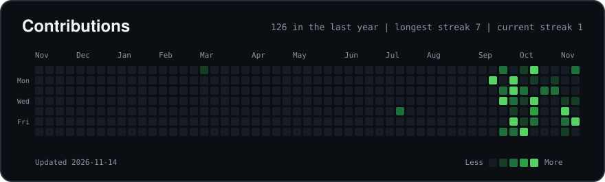

# Adebiyi Joseph Ayomide

**Software Engineer | Web Systems, Backend Architecture & AI Agents**

`Nigeria` · `Open to Freelance, Contract & Remote Engineering Roles`

  
  
  
  
  

---

### Engineering Overview

Software engineer focused on the layers of a system users only notice when they fail: **authorization boundaries, input validation, predictable fallback paths, and durable state persistence**.

My work spans production web applications with row-level database security, autonomous CLI agents with sandboxed tool execution, and rootless Android system utilities. Whether shipping a commercial storefront or a low-overhead mobile tool, I prioritize explicit architecture, modular separation, and verifiable behavior over quick prototypes.

---

### Languages

  
  
  
  
  
  

| Language | Role & Production Usage |
| :--- | :--- |
| **TypeScript / JavaScript** | Primary stack for full-stack web apps, React Native mobile apps, Node.js runtimes, and CLI tool-calling agents |
| **Kotlin** | Native Android engineering with Jetpack Compose, system overlays, and Shizuku IPC integrations |
| **Python** | Automation pipelines, local voice/AI tooling, CLI utilities, and security scripting |
| **SQL** | Relational schema design, PostgreSQL Row-Level Security (RLS) policies, and embedded SQLite persistence |
| **Bash / Shell** | Linux environment administration, build automation, and GitHub Actions CI/CD workflows |

---

### Core Stack

| Domain | Technologies & Patterns |
| :--- | :--- |
| **Frontend & Web** | Next.js, React, Astro, Tailwind CSS, HTML5 / CSS3 |
| **Backend & Data** | Node.js, PostgreSQL, Supabase (Auth & RLS), SQLite, Cloudinary CDN |
| **AI & Agent Systems** | Function/Tool Calling, Multi-Provider Routing & Quota Fallback, Approval Gates, Sandboxed Execution |
| **Mobile & Systems** | Jetpack Compose, React Native, Expo, Android (Shizuku IPC) |
| **CI/CD & Tooling** | Git, GitHub Actions, Vercel, Netlify, Linux |

---

### Selected Systems & Builds

#### 1. [Synsorempire](https://github.com/JoeBuildsThings/synsorempire) — Production E-Commerce & Admin Platform
> **Live:** [synsorempire.vercel.app](https://synsorempire.vercel.app) · **Stack:** `TypeScript` `Next.js` `React` `Tailwind CSS` `Supabase` `Cloudinary` `Vercel`

Live online storefront built for a commercial fashion brand with a private inventory management dashboard and WhatsApp checkout workflow.
* **Access Control:** Enforced database-level isolation using Supabase Authentication and PostgreSQL Row-Level Security (RLS).
* **Media Pipeline:** Automated responsive image resizing and delivery via Cloudinary CDN.
* **Release Hygiene:** Configured GitHub Actions CI pipelines to enforce type-checking on every push.

#### 2. [JOEBOT](https://github.com/JoeBuildsThings/joebot) — Sandboxed Terminal AI Agent
> **Source:** [github.com/JoeBuildsThings/joebot](https://github.com/JoeBuildsThings/joebot) · **Stack:** `JavaScript` `Node.js` `Multi-LLM Routing`

CLI engineering agent engineered around structured tool execution rather than a plain chat wrapper.
* **Tool Runtime:** Reads files, searches codebases, queries the live web, and executes shell commands.
* **Execution Guardrails:** Enforces human-in-the-loop approval prompts before file mutations or shell runs, blocks destructive command patterns, and sandboxes filesystem scope.
* **Resilience:** Routes requests across multiple AI providers with automatic failover on quota exhaustion, backed by persistent local memory.

#### 3. [GameDeck](https://github.com/JoeBuildsThings/gamedeck) — Rootless Android Performance HUD & Optimizer
> **Source:** [github.com/JoeBuildsThings/gamedeck](https://github.com/JoeBuildsThings/gamedeck) · **Stack:** `Kotlin` `Jetpack Compose` `Shizuku` `Android 10–14`

In-game performance telemetry overlay and runtime profile manager requiring zero root access.
* **Telemetry Overlay:** Renders a live floating HUD tracking FPS, frame times, CPU load, RAM usage, and battery thermals.
* **Safe Privilege Escalation:** Uses Shizuku IPC for system-level tuning with one-tap reversible profiles and a hard-coded blocklist protecting core system packages.

#### 4. [Mono Tracker](https://github.com/JoeBuildsThings/mono-tracker) — Offline-First Habit & Routine Engine
> **Source:** [github.com/JoeBuildsThings/mono-tracker](https://github.com/JoeBuildsThings/mono-tracker) · **Stack:** `TypeScript` `React Native` `Expo` `SQLite`

Minimalist mobile habit tracker engineered for instant local reads/writes and deterministic streak calculation using embedded SQLite storage.

#### 5. [UNIOSUN CGPA Calculator](https://github.com/JoeBuildsThings/cgpa-calculator) — 5.0 Scale Academic Engine
> **Source:** [github.com/JoeBuildsThings/cgpa-calculator](https://github.com/JoeBuildsThings/cgpa-calculator) · **Stack:** `JavaScript` `LocalStorage`

Multi-semester GPA/CGPA computation utility built specifically for Osun State University's 5.0 grading system with persistent client-side state.

**Other Public Repositories:**
* [Frost Music Player](https://github.com/JoeBuildsThings/frost-music-player) — Native Android audio player built in Kotlin
* [Vibeo](https://github.com/JoeBuildsThings/Vibeo) — Hybrid social feed and real-time messaging application
* [Portfolio](https://github.com/JoeBuildsThings/joebuildsthings-portfolio) — Personal developer site built with Astro and Tailwind CSS ([Live](https://joebuildsthings.vercel.app))

---

### Current Focus

* **JOEBOT v2:** Refactoring the terminal UI, expanding tool integrations, and tightening sandbox boundaries.
* **Local Inference:** Benchmarking and running local language models via **Ollama** on constrained hardware.
* **Security Engineering:** Studying defensive security fundamentals toward **ISC2 CC** and **CompTIA Security+**.
* **Client Engineering:** Available for freelance backend, full-stack web, and AI workflow automation builds.

---

### Contact

Send over project scope, technical requirements, and timeline:
* **Email:** [adebiyijosephayomide@gmail.com](mailto:adebiyijosephayomide@gmail.com)
* **Web:** [joebuildsthings.vercel.app](https://joebuildsthings.vercel.app)

---

### GitHub Activity

  

